 

  
  
  

---

## About Me

I'm a developer interested in **Artificial Intelligence, Python, and Full Stack Web Development**. I enjoy building practical software that solves real problems, from AI-powered web applications to responsive management systems. I'm continuously improving my skills by building projects and exploring modern development practices.

---

## Tech Stack

  

  <strong>Also working with:</strong> Chart.js · Firebase Authentication · Firebase Realtime Database · REST APIs

---

## Featured Projects

<table>
  <tr>
    <td width="50%" valign="top">
      <h3 align="center">InvestoDeck</h3>
      
<strong>AI Investor Pitch Deck Generator</strong>

      
A web application for generating investor pitch decks using Flask, Python, and Bootstrap.

      
<strong>Technology</strong>

      <ul>
        <li>Python</li>
        <li>Flask</li>
        <li>Bootstrap</li>
      </ul>
      

        
         
        <a href="https://github.com/V-Jasvanth/InvestoDeck">Source Code</a>
      

    </td>
    <td width="50%" valign="top">
      <h3 align="center">Nest Hostel Management System</h3>
      
<strong>Responsive Hostel Management Application</strong>

      
A responsive hostel management application using Firebase Authentication and Firebase Realtime Database.

      
<strong>Technology</strong>

      <ul>
        <li>Firebase Authentication</li>
        <li>Firebase Realtime Database</li>
        <li>Responsive Web Development</li>
      </ul>
      

        
         
        <a href="https://github.com/V-Jasvanth/Nest-Hostel">Source Code</a>
      

    </td>
  </tr>
</table>

---

## Certifications

<table>
  <tr>
    <td width="50%" align="center"><strong>AWS Cloud Practitioner Essentials</strong></td>
    <td width="50%" align="center"><strong>Python using AI</strong></td>
  </tr>
  <tr>
    <td width="50%" align="center"><strong>Deloitte Data Analytics Job Simulation</strong></td>
    <td width="50%" align="center"><strong>Data Science Internship Program</strong></td>
  </tr>
</table>

---

## GitHub Analytics

  
  

  

  

---

## Current Focus

- Building better Python applications
- Learning AI Engineering
- Improving Full Stack Development
- Publishing reliable, well-documented projects

---

## Contact

  
  
  

---

**Thanks for visiting my profile.**

*Building practical software with Python, AI, and modern web technologies.*

